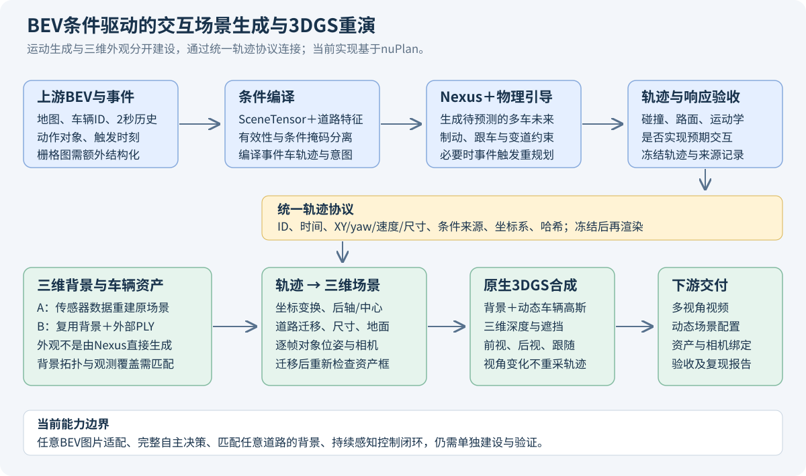

# BEV条件 → Nexus交互生成 → 3DGS动态场景与视频：完整技术路线

版本：2026-11-11。面向当前nuPlan/Nexus/Omniscenegraph本地工程，供项目讨论、实现和交接使用。文中的“已实现”以本仓库代码及2026-11-10归档为依据；“建议接口”和“后续工作”不代表已有通用产品能力。

## 1. 先明确我们到底在做什么

本项目采用分层路线：**从BEV条件生成多车未来运动，再用这些运动驱动三维高斯背景和车辆资产，生成可编辑、多视角的交通事件视频。**

Nexus输出的是位置、朝向、速度和尺寸等交通状态，不是建筑、路面、车辆纹理或高斯点参数。单独一份BEV布局不能唯一确定道路两侧建筑、车辆外观、天空和被遮挡区域。因此，当前实现还必须有三维背景、车辆资产及相机定义。

可以把整套系统理解为三个部分：

| 部分 | 负责回答的问题 | 主要输出 |
| --- | --- | --- |
| BEV条件与事件编译 | 哪条路、有哪些车、当前怎样运动、哪个对象发生什么事件？ | 地图、历史状态、事件条件、条件掩码 |
| Nexus＋交互/物理引导 | 条件改变后，其他车如何运动？自车怎样制动、停车或变道？ | 多车时序状态及控制记录 |
| 轨迹桥接＋3DGS | 这些车在三维空间里放在哪里、长什么样、相机怎么看？ | 可回放动态场景配置、相机图像和视频 |

**更准确的项目名称是“BEV条件驱动的交互场景生成与3DGS重演”，当前不宜称为“Nexus直接生成3DGS”或“任意BEV端到端生成真实世界”。**



## 2. 在整个项目中的位置、上游输入和下游输出

我们的模块位于“事件需求/BEV场景描述”之后、“传感器视频输出及下游测试”之前。

上游可以提供真实场景缓存，也可以提供从编辑器、规则或其他模型得到的事件需求。当前已实现的主要入口是nuPlan地图、车辆历史和人工编译的事件轨迹，并非任意自然语言或BEV图片均已自动接入。

| 上游输入 | 必须说明的内容 |
| --- | --- |
| 道路 | 车道中心线、边界、连接关系、行驶方向、可行驶区域；单位为米 |
| 车辆历史 | 稳定ID、位置、航向、速度、长宽、存在掩码；当前配置需要2秒历史 |
| 事件 | 编辑对象、动作类型、触发时刻、持续时间或目标车道；必要时给定未来轨迹 |
| 控制范围 | 哪些未来状态固定、哪些由Nexus生成；是否给自车停车或变道意图 |
| 三维背景 | 已重建背景检查点及其地图/坐标关系，或用于重建的传感器数据 |
| 车辆外观 | 对应实例高斯资产，或可插入的外部PLY资产及尺寸/轴向信息 |
| 相机 | 视角类型、内参、安装外参、分辨率、帧率 |

下游不仅得到MP4，还应得到：场景协议、全部角色轨迹、固定/生成状态说明、资产绑定、坐标变换、地面参数、相机轨迹和验证报告。有了这些中间数据，才能更换相机重复渲染，而不必重新生成车辆行为。

## 3. “BEV condition”在本项目中具体指什么

### 3.1 当前模型使用结构化BEV状态

主要特征由 `nuplan_extent/planning/training/preprocessing/features/scene_tensor.py` 定义：

```text
SceneTensor.tensor           [B, N, T, 8]
SceneTensor.validity         [B, N, T]
SceneTensor.road_graph       道路折线特征
SceneTensor.road_graph_validity
task_mask                   [B, N, T, 8]

8个状态通道：
[x, y, cos(yaw), sin(yaw), vx, vy, length, width]
```

其中B为批大小，N为参与者数量，T为时间点数量。N可填充，不能把填充车辆当成真实车辆。当前实验中槽位0为自车，其他槽位要显式绑定稳定角色/ID，不能依赖渲染时的数组行序猜身份。

当前采用0.5秒状态间隔：

```text
索引      0    1    2    3    4    5    6  ... 20
时间/s   -2  -1.5  -1  -0.5  0   0.5   1  ...  8
          └──历史含当前5点──┘   └──未来16点──┘
```

这是本轮配置，不是说模型任何输入长度都能直接互换。

### 3.2 如果上游只有一张BEV图片

必须先建立适配器，提取/补充米制地图、车辆框、朝向、类别、ID和历史。单帧通常没有足够信息确定速度、加速度、运动意图和遮挡后对象的状态。

至少需要补充像素到米制坐标的映射、时间信息及状态估计。**“任意BEV栅格图→SceneTensor”目前是待统一的上游能力，不能跳过这一步，直接把PNG送入当前轨迹采样接口。**

### 3.3 归一化与两种掩码

实际物理状态记为s，模型输入记为u，代码约定为：

```text
u = (s - mean) / (2 * std)
s = u * (2 * std) + mean

mean = [0, 0, 0, 0, 0, 0, 4.5, 2]
std  = [52, 52, 0.5, 0.5, 2, 2, 2.5, 0.8]
```

不能漏掉系数2。模型中的XY归一化尺度为104米，不是52米。

| 掩码 | 含义 | 常见错误 |
| --- | --- | --- |
| validity | 该车辆在该时刻是否存在、状态是否有效 | 把未知未来设为不存在，车辆直接消失 |
| task_mask | 该通道是否作为已知条件固定 | 把希望模型预测的自车未来误设为固定 |

要让自车未来待生成，应保持其有效性为真，而未来条件掩码为假，并清零未条件化输入。这里的0是“未提供条件”的张量占位，不能直接解释为物理世界中的静止车辆。

## 4. 把事件需求编译成模型条件

例如“危险车切入→自车闪躲→影响后车→后车交互”，必须先指定道路、角色和事件，而不是只写动作名称。

### 4.1 三种实际可用的组织方式

| 方式 | 条件组织 | 适合场景 | 限制 |
| --- | --- | --- | --- |
| 历史条件生成 | 提供全部参与者历史，未来由模型采样 | 查看自然运动分布、正常对照 | 不保证指定车辆一定在未来某时刻切入 |
| 指定事件车未来 | 固定A的历史和事件轨迹，其余未来待生成 | 明确制造急刹、切入、逆行侵入 | 模型可能提前知道整段事件并提前响应 |
| 事件触发后续写 | 先执行正常生成前缀，触发时更新历史/条件，再生成续段 | 演示突发事件后的反应 | 当前只实现了有限阶段重规划，不是完整在线闭环 |

未来某时刻的行为约束，在目前工程中通常先编译成连续的事件车轨迹，再交给Nexus；并不意味着已有一个通用“3秒cut-in”的原生语义按钮。

### 4.2 事件编译应做的工作

1. 判断道路是否支持该动作：相邻车道方向、车道宽度、隔离带、前后空间。
2. 从当前状态和历史速度构造连续动作，避免位置/航向瞬移。
3. 预检给定事件车自身是否出路面、穿过静止物体或有异常加速度。
4. 明确哪些行为由条件指定，哪些响应需要模型生成。
5. 给随机采样保存种子、条件文件及哈希，保留失败样本。

一个事件发生了，不等于它影响了自车。例如对向车在交会前就返回，虽然形式上越线，自车可能完全不需要避让。要通过初始距离、相对速度和持续时间构造有冲突的输入，再检查响应，不能只看“事件车动了”。

## 5. Nexus如何生成交互运动

本地推理入口包括 `scripts/pipeline/run_hazard_response_v2.py`。基本流程是装载检查点，将地图/条件状态送入模型，采样未来，并在采样过程中应用本地控制空间物理引导。

```python
features = SceneTensor(
    tensor=conditioned_values,
    validity=actor_validity,
    road_graph=road_graph,
    road_graph_validity=road_graph_validity,
)
result = model.forward_inference(
    {"scene_tensor": features, "task_mask": condition_mask},
    noise=noise,
)
sampled_states = result["sampled_tensor"]
```

这是接口示意，省略了模型配置、设备和引导初始化，不能独立复制运行。

### 5.1 为什么当前还需要物理/行为引导

采样出来的轨迹不自动等于可用于演示或测试的合理运动。之前出现过车身重叠、漂移、无故减速、面对静止车重新加速，以及对向冲突时加速穿过等问题。

当前通过控制空间推进车辆状态，并加入碰撞、道路、航向、跟车、加速度、曲率和舒适性等项。停车/变道还可以有显式响应意图。其概念可写为：

```text
采样/优化目标 = 模型先验相关项
              + 碰撞及道路约束
              + 运动学与控制约束
              + 任务对应的停车/变道意图项
```

这只是目标构成说明，不是原始Nexus论文损失函数的逐项复述。实际实现与权重以归档配置和源码为准。

### 5.2 两类已补充的响应意图

**停车意图：** 关闭自车的恢复巡航目标，检测阶段之后限制正加速度，加入终端停车速度和目标停车位置代价。这样解决“前面有静止车，片尾却重新加速”的问题。

**变道意图：** 提供可行的同向相邻车道、软空间路线和目标车道车身完成约束。原车道的强约束要改成允许穿越两个同向车道的走廊，否则优化器会被锁在原车道。

上述实现位于 `scripts/pipeline/hazard_response_refiner.py`。**自车未来状态未固定，不等于动作完全由原始模型自主决定。** 当前第三、四类的变道是新增意图引导后的结果，不能作为纯Nexus自主决策能力的证据。

### 5.3 多车因果链怎样验证

要证明A影响B、B又影响C，至少要同时检查：A事件确实改变；B/C未来未直接固定；响应顺序与空间关系合理；无事件对照和事件分支存在相应差异。若B被指定“必须变道”，不能再把B变道本身当作模型自发响应。

目前四类试验主要是少量角色车辆的事件演示，不构成任意多车拥挤场景的泛化验证。省略的原交通参与者若要恢复，就必须进入联合生成、回放或约束检查范围，不能只在图像里加回去而不检查碰撞。

## 6. 事件触发后重规划：避免提前反应

最新急刹和静止车试验使用一次事件触发的分阶段生成：

```text
正常条件 → Nexus生成正常轨迹 → 执行到1.5秒
                                  ↓
                         引入急刹或静止车信息
                                  ↓
                  截取截至此时的2秒已执行历史
                                  ↓
                  移动/旋转到新的自车局部坐标系
                                  ↓
                      Nexus重新采样剩余运动
```

第一段已经执行的自车前缀保持不变，续段从同一当前状态开始。拼接是时序执行与重规划，不是把一条失败轨迹事后手工拖到安全位置。

第一类前缀模型看不到未来急刹条件；第二类前缀模型不接收S车。1.5秒是人为定义的事件信息输入时刻，不是视觉网络检测出的时间。第二类正常对照中A同样变道，前方没有S车。

重规划必须同步变换车辆历史、速度向量、道路特征、空间路线及世界坐标变换。只平移车辆框、不变换地图，会导致道路和车辆错位。新一轮未来自车条件仍应为假。

目前还没有持续执行“每一控制周期感知→预测→规划→执行”的完整系统，因此文档和演示应使用“事件触发重规划”，不使用“已验证完整在线闭环”这一表述。

## 7. 中间轨迹协议：把行为生成与渲染解耦

建议采用统一轨迹包作为两套环境间的接口，最少包含：

```text
scenario_id / map_name / coordinate_frame / units
timestamps / dt / current_index
actor_id / role / category / validity
XY / yaw / velocity / length / width
condition_mask / condition_source / response_intent
world_from_nexus / source_prediction_hash
```

当前实际文件有 `prediction.pt`、`conditions_*.npz`、`scene.pt`、`protocol.json`、`run.json`；原有通用桥接还支持 `manifest.json` 与轨迹NPZ。上述字段是统一接口建议，不代表所有现存文件已使用同一schema。

分阶段试验还保存：

- `raw_stage_prediction.pt`：该阶段原始模型采样。
- `prediction.pt`：在全局片段时间线中执行的轨迹。
- `sampling_inputs/replan.json`：触发时间、坐标变换和前缀来源。
- `guidance.json`、`controls.npy`：引导项记录及控制结果。

渲染端不应静默修补这些源预测。需要迁移到另一背景时，应保存独立的派生轨迹及映射说明，并重新验证。

## 8. 三维背景和车辆资产从哪里来

### 8.1 路线A：在原场景重建并编辑

输入同一真实场景的多相机RGB、内外参、相机曝光时间对应的自车位姿、LiDAR及动态对象标注，转换为Omniscenegraph数据目录，再训练/重建背景和动态对象。

```text
传感器数据与标定
  → 图像去畸变、点云/坐标转换、时间对齐、实例整理
  → 静态背景与动态车辆分离
  → Omniscenegraph训练
  → 背景高斯＋对象局部高斯＋对象身份映射
  → 用Nexus轨迹驱动对象和相机
```

关键要求：先用真实轨迹和原相机验证重建注册，再替换为生成轨迹。若不能复现真实轨迹的正确投影，后续生成画面很难判断错误来自模型还是渲染。

通用数据转换入口为 `scripts/pipeline/export_nexus_3dgs.py` 和 `prepare_nuplan_3dgs.py`，训练/渲染环境入口为 `scripts/pipeline/nexus_3dgs.sh`，已有详细记录见 `docs/nexus_3dgs.md`。

### 8.2 路线B：复用背景，插入外部车辆高斯资产

这是最新四类高斯视频实际采用的路线：复用scene121道路背景，将 `hzy/3dgs_pro/1.ply`、`3.ply` 作为车辆外观，根据迁移后的轨迹逐帧摆放。

优点是可以更快复用背景、更换车辆；限制是需要道路拓扑、长度、宽度及观测覆盖匹配。不同场景借用同一个背景，只能称为合成重演，不能称为对应原始道路的忠实重建。

### 8.3 如果没有背景、只有BEV条件

还缺少三维几何与外观先验。可以另接道路三维资产库、程序化道路或生成式三维场景系统，但这不是当前Nexus权重已有的功能。当前不能承诺从任意BEV草图自动生成完整、可信的道路与建筑高斯模型。

## 9. 从BEV轨迹恢复三维位姿

### 9.1 坐标链

明确区分：Nexus局部坐标、地图世界坐标、3DGS场景坐标、对象局部坐标和相机坐标。

用 `T_A_from_B` 表示将B坐标变换为A坐标的4×4矩阵，则：

```text
T_world_from_actor(t) = T_world_from_nexus × T_nexus_from_actor(t)
T_scene_from_actor(t) = inverse(T_world_from_scene) × T_world_from_actor(t)
T_scene_from_camera(t) = inverse(T_world_from_scene) × T_world_from_camera(t)
```

nuPlan世界坐标数值可能很大，先在双精度中完成世界/场景变换，再送入渲染器使用场景坐标，避免直接把大数值世界坐标作为GPU单精度位置。

### 9.2 自车后轴点与车体中心

当前自车状态以nuPlan车辆约定的后轴点为参考，而其他车辆通常以框中心为参考。当前Pacifica参数下，框中心相对后轴沿车头方向约1.461米：

```text
center_ego_xy = rear_axle_xy + 1.461 * [cos(yaw), sin(yaw)]
```

这是当前车辆参数，不是所有自车通用常量。更换车型时应重新读取车辆几何。重复加或漏加这个偏移，会直接改变跟车间距、碰撞结果和相机位置。

### 9.3 高度、坡度与接地

Nexus的8通道不包含z、roll、pitch、车辆高度。需要通过重建对象安装关系、局部路面或LiDAR拟合得到这些量。

例如地面平面为 `a*x+b*y+c*z+d=0`，则 `z=-(a*x+b*y+d)/c`。根据地面法向和航向构造车辆旋转，再把资产局部中心抬升半个车高，使资产底部接近路面。

当前还采用局部高度剖面补偿；该剖面只对已经验证的背景有效，不能复制给任意新道路。包围框底面接地也不保证可见轮胎准确接地，因为资产噪声、轮胎几何、路面重建误差和阴影近似都可能产生悬浮感。

### 9.4 时间插值

生成状态为0.5秒间隔，当前渲染采用0.1秒间隔。最新桥接对平移插值、对航向采用连续角度处理；较通用的三维姿态路径可使用四元数SLERP。不能直接线性插值跨越正负π的裸角度。

不能跨无效区间补出不存在的车。重规划为凑足模型预测窗口所构造的额外未来上下文，应与实际展示的0–8秒区间区分，不能当成新的真实观测。

## 10. 换背景时怎样摆放轨迹

若源道路与背景道路不同，只做一个平移/旋转往往不够。当前使用道路参考曲线的弧长和横向偏移迁移。

设源参考线为r(s)，法向为n(s)，车辆位置近似写为：

```text
p(t) = r(s(t)) + l(t) * n(s(t))

迁移后：
p_new(t) = r_bg(s0 + s(t) - s_ref)
         + (alpha * l(t) + beta) * n_bg(...)
```

其中s0是背景摆放起点，alpha处理车道间距差异，beta是整体横向偏移。航向也必须随参考线方向和横向映射一致变化。这个过程会改变世界坐标路径和道路弯曲，不应声称所有欧氏距离、加速度和姿态逐位不变。

最新四类试渲最终采用 `alpha=1.0`、`beta=-0.4米`。源预测文件未修改，派生摆放另存。迁移后对实际渲染资产的包围框重新检查：81个时刻均无包围框重叠或超出所用三车道路面。

**拓扑优先于画面美观。** 同向三车道不能作为原双向道路中心线场景的忠实重建。当前第四类借用该背景，只能展示“逆向来车侵入、自车避让”。严格的双向道路版本需要匹配背景或重新重建。

## 11. 如何用三维高斯资产表示动态车辆

每个车辆资产有一组局部高斯，主要参数包括中心、旋转、尺度、不透明度和球谐颜色系数。它们来自已有重建/外部PLY，不来自本轮Nexus预测。

对局部高斯中心mu、协方差Sigma、车辆位姿R和t：

```text
mu_world(t) = R(t) * mu_local + t(t)
Sigma_world(t) = R(t) * Sigma_local * transpose(R(t))
```

整体统一缩放时，中心和高斯标准差同时缩放，不能只改车辆框。球谐外观按资产局部观察方向求值，避免车一转向颜色就错乱。

`nexus_3dgs/inserted_vehicle.py` 已处理：PLY的log尺度、logit透明度、四元数顺序、标准channel-major球谐布局、统一缩放和高斯支撑范围约束。不能把不同导出格式未经检查地混用。

当前缩放策略是在保留资产比例的前提下，使其落入预测长宽范围内；渲染车辆可能比原预测框略小。因此要分别报告“轨迹框检查”和“实际渲染资产框检查”，不能用缩小资产掩盖本来重叠的轨迹。

对象身份有两种情况：原场景重建用稳定track token绑定模型实例；插入新车用显式的role/actor_id到asset_id映射。渲染时临时替换动态实例/高斯集合，不得把原车和新资产重复显示，造成重影。

## 12. 原生3DGS渲染与多视角输出

每个时刻把静态背景、动态车辆高斯和需要的其他节点交给同一渲染后端，经过相机投影和深度相关合成得到RGB。当前依赖Omniscenegraph/gsplat路径，车辆遮挡来自三维合成，不是把车图贴在二维背景视频上。

相机应包含内参K和逐帧外参。自车相机满足：

```text
T_world_from_camera(t)
  = T_world_from_ego_body(t) × T_ego_body_from_camera
```

| 相机模式 | 用途 | 注意事项 |
| --- | --- | --- |
| 原始标定相机 | 检查重建注册，接近原始观测 | 曝光时间、内参和训练校正需一致 |
| 自车前视/后视 | 查看急刹、遮挡、后车逼近 | 当前部分相机为虚拟安装，不是标定传感器 |
| 外部跟随视角 | 直接看清哪辆车变道及交会 | 必须说明跟随对象、相机轨迹 |
| 多视角同步输出 | 同时观察不同方向的交互 | 换视角只换相机，不重新采样车辆运动 |

自车视角通常隐藏本车资产以避免车体遮挡；没有车内资产时，不能宣称重建了真实驾驶舱。移动相机时，相机射线、背景/天空相关输入都要同步更新。

新视角看不到真实观测支撑的路面、树木、车后部，仍可能模糊或缺失。更多相机覆盖、对应区域数据或重建优化能补这一环，单纯给更好的车辆资产不能补全背景。

## 13. 一个完整例子：前车变道露出静止车

| 阶段 | 实际处理 |
| --- | --- |
| 输入 | E跟随A行驶，S位于A前方；道路允许A变道 |
| 世界与模型信息 | S在物理场景中从开始就存在，但前缀模型不接收S；区分遮挡与条件可见性 |
| 正常前缀 | A按给定轨迹变道，前方无S条件，Nexus生成E正常运动 |
| 触发 | 1.5秒向模型加入S信息，取此前已执行E历史重新采样 |
| 响应 | 关闭巡航恢复，约束停车阶段不再正加速，生成减速停车 |
| 行为验证 | S最初被遮挡，约1.7秒九成可见；E约6.5秒停稳，最终净距约3米 |
| 3DGS适配 | 将轨迹迁移到scene121，给E/A/S绑定车辆资产，补高度与地面朝向 |
| 图像输出 | A的高斯车体先挡住S，A离开后S显露；自车视角显示逐渐接近并停下 |
| 能说明什么 | 条件触发后的轨迹续写、停车意图和三维遮挡渲染链路已接通 |
| 不能说明什么 | 未证明视觉网络自动发现S，也未证明原始Nexus无引导自主学会停车 |

另外三类的最新响应证据：急刹初始净距约12米，E约5秒停稳；高速后车场景E约3.7秒完整进入相邻车道；对向侵入场景E约3.1秒完整进入外侧同向车道。它们是具体实验结果，不是通用成功率。

## 14. 两次验收：先验轨迹，再验图像

| 层级 | 必查项 | 典型失败 |
| --- | --- | --- |
| 输入 | 历史/单位/坐标/ID/掩码/道路拓扑 | 自车未来被意外固定、事件车自己穿模 |
| 生成轨迹 | 碰撞、车身出路面、速度/加速度、倒行、航向一致性 | 无故减速、漂移、停后加速 |
| 行为响应 | 急刹是否影响E、是否停稳、哪辆车变道、目标车道是否完成 | 事件有动作但没有实际冲突，响应对象错误 |
| 背景迁移 | 映射后车身/资产框、道路边界、时序和转向 | 源轨迹安全，换背景后压路沿或重叠 |
| 资产与三维姿态 | 轴向、比例、中心、轮胎接地、身份、重复外观 | 悬浮、朝向翻转、原车重影 |
| 相机与图像 | 遮挡、视野、缺失区域、闪烁、纯高斯画面 | 视频没拍到交互、相机跳变、新视角碎裂 |
| 可复现 | 种子、条件/预测/资产/检查点哈希、配置及失败记录 | 视频无法对应输入，修改旧证据 |

当前轨迹侧检查未来80个0.1秒采样；高斯摆放侧含当前共81个时刻。这不是连续时间碰撞证明。生成反事实没有对应的真实视频，不能直接把它与原图的PSNR当成反事实真实性指标。

## 15. 已实现、仍依赖人工、后续待补齐

| 能力 | 当前状态 |
| --- | --- |
| 结构化历史/地图条件接入Nexus | 已实现，基于nuPlan |
| 给定A未来、其他对象未来待生成 | 已实现，但不保证全部样本行为合理 |
| 事件触发一次重规划 | 已实现于急刹/静止车演示 |
| 停车与相邻车道意图引导 | 已实现，属于新增控制引导 |
| 原场景对象绑定和高斯渲染 | 已有接入及公交车等实验 |
| 外部车辆资产插入与背景重演 | 已实现，本轮四类试渲采用此路线 |
| 自车/外部多视角 | 已实现，部分新视角质量有限 |
| 任意BEV图片自动适配 | 尚未形成通用入口 |
| 任意自然语言事件自动编译 | 当前主要人工/脚本编译，待统一 |
| 任意道路自动选择高质量匹配背景 | 尚未实现通用检索与验收 |
| 原双向道路第四类忠实高斯重建 | 当前背景不匹配，需另选或重建 |
| 完整视觉感知与持续闭环执行 | 尚未实现 |
| 任意多车拥挤场景稳定交互 | 未经系统验证 |
| 仅从BEV自动补全三维外观 | 不属于当前已实现链路 |

建议下一步依次完成：统一输入/输出schema和ID；把实验脚本的硬编码场景/输出路径改成配置；增加背景拓扑与观测覆盖检索；补齐第四类真实双向背景；在更完整交通参与者范围开展配对验证；再扩展连续重规划和真实感知接口。

## 16. 当前代码与数据索引

以下代码路径均相对Nexus仓库根目录。

| 功能 | 入口 |
| --- | --- |
| BEV特征与归一化 | `nuplan_extent/planning/training/preprocessing/features/scene_tensor.py` |
| 道路筛选 | `scripts/pipeline/scan_hazard_response_roads.py` |
| 事件输入准备 | `scripts/pipeline/prepare_hazard_response_v2.py` |
| 目标车道距离场补全 | `scripts/pipeline/finalize_hazard_response_inputs.py` |
| 采样与分阶段重规划 | `scripts/pipeline/run_hazard_response_v2.py` |
| 停车/变道意图 | `scripts/pipeline/hazard_response_refiner.py` |
| 响应验证 | `scripts/pipeline/audit_hazard_response_v2.py` |
| 轨迹导出与坐标基础 | `nexus_3dgs/bundle.py`、`geometry.py` |
| 高斯背景迁移 | `scripts/pipeline/prepare_response_gaussians.py` |
| 背景车道适配 | `scripts/pipeline/fit_response_gaussian_lanes.py` |
| PLY资产变换 | `nexus_3dgs/inserted_vehicle.py` |
| 渲染器与相机接口 | `nexus_3dgs/replay.py` |
| 四类原生高斯渲染 | `scripts/pipeline/render_response_gaussians.py` |
| 视频与页面打包 | `scripts/pipeline/report_response_gaussians.py` |
| 原场景重建接入说明 | `docs/nexus_3dgs.md` |

项目根目录：

```text
/inspire/hdd3/project/intelligent-driving-agent/public/workspace/hzy/
  nexus_repro/Nexus/                         代码与实验
    artifacts/nexus_hazard_response_v2_20261110/
      protocol.json                         事件定义和角色
      response_seed0/run.json                推理配置与哈希
      response_verification.json             响应检查
    artifacts/nexus_response_gaussians_20261110/
      protocol.json                         背景、源预测、迁移方法
      lane_fit.json                         最终车道适配
      geometry_audit.json                    高斯资产框检查
      render_run.json                       相机、资产和权重验证
      source_snapshot/                      实现快照
  3dgs_pro/1.ply、3.ply                      用户提供车辆资产
  report/nexus_hazard_response_v2_20261110/   运动示意与对照
  report/nexus_response_gaussians_20261110/   高斯试渲与多视角
  others/                                   技术路线与交接说明
```

Nexus使用 `../envs/nexus/bin/python`，3DGS使用 `artifacts/nexus_3dgs/venv/bin/python` 和封装脚本设置的本地依赖。通过文件协议连接两个环境，避免为渲染修改Nexus环境。

## 17. 执行顺序与复现注意事项

下列是当前实验脚本的执行顺序，**不是可盲目覆盖现有目录的“一键命令”**。多个脚本的OUT/SRC/BG等路径仍硬编码，重复实验前应统一改为新的实验目录，并检查各脚本读取的是同一版本。历史归档不覆盖。

```bash
# 在Nexus仓库根目录，使用新的输出目录配置
export OMP_NUM_THREADS=2
export OPENBLAS_NUM_THREADS=2

# 1. 道路与条件准备
../envs/nexus/bin/python scripts/pipeline/scan_hazard_response_roads.py
../envs/nexus/bin/python scripts/pipeline/prepare_hazard_response_v2.py
../envs/nexus/bin/python scripts/pipeline/finalize_hazard_response_inputs.py

# 2. 生成并验收轨迹
../envs/nexus/bin/python scripts/pipeline/run_hazard_response_v2.py
../envs/nexus/bin/python scripts/pipeline/audit_hazard_response_v2.py

# 3. 准备高斯背景摆放
../envs/nexus/bin/python scripts/pipeline/prepare_response_gaussians.py

# 4. 首次渲染，得到实际资产尺度与初始诊断
bash scripts/pipeline/nexus_3dgs.sh script \
  "$PWD/scripts/pipeline/render_response_gaussians.py"

# 5. 根据实际资产框调整摆放；该脚本会保留首次渲染目录
../envs/nexus/bin/python scripts/pipeline/fit_response_gaussian_lanes.py

# 6. 重新渲染最终摆放方案并打包
bash scripts/pipeline/nexus_3dgs.sh script \
  "$PWD/scripts/pipeline/render_response_gaussians.py"
artifacts/nexus_3dgs/venv/bin/python scripts/pipeline/report_response_gaussians.py
```

步骤4→5是当前实验脚本对实际资产尺度的依赖，不是最优通用架构。后续应把资产尺寸读取和摆放检查前置到渲染前，只在检查通过后执行完整视频渲染。

若没有现成背景，应先走第8节路线A的数据准备、背景/资产重建和原轨迹注册验证，再进入上述渲染步骤。增加模型训练轮数、资产插入和Nexus权重训练是三件不同的事，应分别记录。

## 18. 对外汇报可以采用的表述

> 本项目以道路拓扑、车辆历史和事件条件构建结构化BEV输入，利用Nexus及显式交互/物理引导生成多车未来运动；随后通过身份绑定、坐标变换、道路适配和地面注册，将运动转换为动态高斯资产及相机位姿，结合预重建背景进行原生3DGS多视角渲染，输出交通事件视频和可复现的场景协议。当前已完成四类危险事件的运动与高斯重演验证；任意BEV图像接入、完全自主行为选择、严格双向背景匹配及完整在线感知控制闭环仍需进一步建设。

不应使用的表述包括：“Nexus直接预测高斯点”“仅凭BEV生成任意真实场景”“变道证明原始Nexus自主学会避让”“四类均已完成原场景照片级重建”“采样无碰撞等同于安全认证”。

本文基于本地实现与归档整理，不改变模型、轨迹、资产或已有试验结果；未包含密钥、私钥或服务认证信息。
