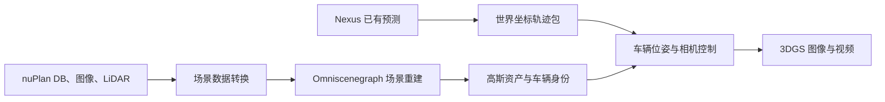

# Nexus 接入 Omniscenegraph 3DGS（nuPlan）

本地接入代码位于 `nexus_3dgs/`，渲染后端使用复制到 `Omniscenegraph/` 的工程。
Nexus 生成交通参与者的未来状态，Omniscenegraph 使用同一真实场景重建的高斯资产生成相机图像。
公开 Nexus 工程没有可直接切换的 NeRF 后端配置，因此这里新增了下游 3DGS 接口。



## 已验证的范围

最新多车交互、巴士轮廓优化和中文图例见 [optimization_v3 说明](nexus_3dgs_optimization_v3.md)。早期的[相同预测稳定性对照](../artifacts/nexus_3dgs/stability_comparison/same_prediction_before_after.mp4)和[终点条件多车生成](../artifacts/nexus_3dgs/goal_grounded_multiagent/multiagent_and_camera.mp4)保留为诊断基线；它们仍有后续已定位的轨迹与外观问题。

- 已兼容已有单场景 `prediction.pt` 和多场景 `run.json` / `frozen_plan.json` 结果格式。
- 两份真实预测分别导出 55、14 个有效参与者（含自车）。还原参考轨迹后，对 nuPlan 世界坐标的最大位置误差小于 `0.000008 m`。
- 已准备一个有完整本地图像和 LiDAR 的场景：`a89c1931e7b25976`，10 Hz、101 帧、101 张前视图像、27 个标注实例、9,831,051 个点。图像链接到共享目录，点云转换为六列 float32。
- `scripts/pipeline/check_nexus_3dgs.py` 的 16 项检查通过，覆盖坐标、时间插值、身份重排、检查点身份保存、渲染失败后位姿恢复、相机射线同步、二进制 PCD、无语义掩码的相机初始化/RGB 训练/背景点云过滤，以及保留三维配准和坡面上的车辆/相机标定；同时检查了全部已转换点云大小和图像完整性。
- `artifacts/nexus_3dgs/projection_diagnostic.png` 是真实相机图像上的参考/预测车辆框投影，用于检查标定和轨迹。**它不是 3DGS 渲染结果。**

独立环境及首轮 5000 步重建已完成，`runtime_probe.json` 中的 PyTorch3D CUDA KNN、gsplat 光栅化/反向传播、nvdiffrast 天空纹理/反向传播和实际训练入口检查均通过。最终权重的原始轨迹与 Nexus 控制视频各 80 帧、10 FPS、960×540，均已逐帧解码验证。13 辆 Nexus 目标车全部绑定，前视相机跟随生成自车，无缺失外观轨迹。

- [首次接口验收三列对照视频（旧接入，保留对照）](../artifacts/nexus_3dgs/comparison_integration5000/comparison_camera_0.mp4)
- [首次接口验收预览](../artifacts/nexus_3dgs/comparison_integration5000/comparison_preview.png)
- [首次渲染检查报告](../artifacts/nexus_3dgs/comparison_integration5000/verification.json)

对照视频依次展示真实图像、原始轨迹 3DGS、Nexus 轨迹及自车相机 3DGS。当前属于单场景接入验证，局部车辆边缘、新视角路面仍有模糊和伪影，尚未开展多场景画质验证或完整 30000 步训练。

### 车辆近乎静止与公交车晃动的修正

旧 BP 样本中，自车未来 8 秒路径仅 0.51 m、公交车 1.66 m，而原始轨迹分别为 4.81 m、9.39 m。原先的“7 辆车变化超过 1 米”衡量的是与原始轨迹的差异，不能用作车辆实际行驶距离。固定输入及单场景随机数的约束对照中，去掉 SMA 后公交车仍只移动 1.76 m，不能将停滞主要归因于平滑约束。

旧接入还把原始标注的 z、零 roll/pitch 覆盖到训练优化过的车辆姿态，并丢弃了训练相机校正。单独保留逐帧训练配准后，仍有高频几何变化。因此增加了可选的局部 LiDAR 地面约束：排除车辆点后拟合坡面，保留 Nexus XY/yaw，用固定的三维车辆配准和相机安装标定处理模型未生成的高度、倾角。该场景 894/1571 个候选米制单元支持坡面，内点 RMSE 0.038 m；超出支撑范围的物体回退到原重建加平面位移，不外推路面模型。该假设只适用于已检验的局部路面。

- [完全相同 BP 预测的旧/新接入对照视频](../artifacts/nexus_3dgs/stability_comparison/same_prediction_before_after.mp4)
- [修正后普通预测视频](../artifacts/nexus_3dgs/render_generated_grounded/camera_0.mp4)
- [终点条件多车生成＋同步俯视轨迹](../artifacts/nexus_3dgs/goal_grounded_multiagent/multiagent_and_camera.mp4)
- [实际公交车后部纹理的光流检查](../artifacts/nexus_3dgs/stability_audit/image_motion.json)

同一 BP 预测的公交车后部持久纹理跟踪，竖向变化范围由 10.35 px 降到 0.30 px；三维中心投影的竖向范围由 8.39 px 降到 0.20 px。这些是公交车局部几何/纹理运动指标，不能代替整段视频的闪烁或外观质量评估。

终点条件分支 `intent_conditioned_behavior_pred` 使用真实未来终点作为条件，Nexus 生成中间轨迹；自车路径 5.11 m、公交车 8.84 m。它更直观地展示多车运动，但不是新设计的交互反事实实验。改轨后暴露的未观察区域仍有显著外观伪影，包括个别高斯颜色异常，不能把几何稳定性改善当成照片级重建已经完成。

### 多车生成与交互验证的范围

当前接入样本使用 `behavior_pred`：固定所有参与者的历史，联合预测自车和 13 辆其他车辆的未来。它没有设置切入、急刹等交互条件，也没有做条件改变后其他车辆响应的配对实验。13 辆车完成身份绑定、视频像素发生变化，都不能证明模型已经生成了有意义的交互。

[同步俯视轨迹与相机视频](../artifacts/nexus_3dgs/multiagent_audit/multiagent_and_camera.mp4) 展示同一颜色/ID 的原始轨迹和 Nexus 轨迹；[轨迹审计](../artifacts/nexus_3dgs/multiagent_audit/trajectory_audit.json) 中有 7 辆其他车辆在至少一个有效未来采样点与原始位置相差超过 1 米。这只是位置差异统计。要验证交互，需要固定相同历史和采样随机数，改变明确的车辆动作条件，再检查未被直接指定的其他车辆如何响应。

后续画质、遮挡投影、多相机覆盖和公交车条件响应实验记录在 [分步改进文档](nexus_3dgs_improvements.md)。新的数据准备配置启用最近深度投影与 64 分辨率有界天空；此前冻结的实验配置保留原行为。

左侧面包车和侧车噪声、条件穿模的最新修复及命令见 [后续修复记录](nexus_3dgs_followup.md)，该记录明确区分原 Nexus 输出、重建改进和下游过滤结果。

## 路径与命令

以下数据准备命令从 Nexus 根目录执行，使用已有 Nexus 环境：

```bash
NEXUS_PY=/inspire/hdd3/project/intelligent-driving-agent/public/workspace/hzy/nexus_repro/envs/nexus/bin/python

# 只读审计依赖、传感器文件及已有预测中可用的场景
"$NEXUS_PY" scripts/pipeline/audit_nexus_3dgs.py --probe-runtime --find-sensor-scene

# 已选场景：只按传感器可用性选择已有 seed-0 预测，没有按生成质量筛选
"$NEXUS_PY" scripts/pipeline/export_nexus_3dgs.py \
  --run-dir artifacts/nuplan_evaluation/independent256_v1 \
  --prediction artifacts/nuplan_evaluation/independent256_v1/released_test_recipe_096_seed0.pt \
  --task behavior_pred \
  --output artifacts/nexus_3dgs/nuplan_sensor_scene

"$NEXUS_PY" scripts/pipeline/prepare_nuplan_3dgs.py \
  --bundle artifacts/nexus_3dgs/nuplan_sensor_scene

"$NEXUS_PY" scripts/pipeline/check_nexus_3dgs.py
```

输出目录为：

```text
artifacts/nexus_3dgs/
  input_audit.json                     环境与输入审计
  verification.json                    检查结果与真实数据统计
  demo_scene_gen/                       原 demo 的轨迹包（55 个参与者）
  nuplan_sensor_scene/                  可用场景的轨迹包（14 个参与者）
  projection_diagnostic.png             投影诊断图
  processed/
    2021.10.05.04.38.41_veh-50_00014_00429__a89c1931e7b25976/
      images/                          共享原图的符号链接
      lidar/                           [x,y,z,intensity,ring,lidar_id]
      ego_pose/                        LiDAR 时间的自车世界位姿
      camera_ego_pose/                  各相机实际曝光时间的自车位姿
      intrinsics/、extrinsics/           相机标定
      instances/                       真实标注与原始 track token
      nexus_scene.json                  数据来源、时间戳与准备状态
      train_config.yaml                此场景的重建配置
```

原 demo 对应的图像/LiDAR 在共享数据中缺失，已留下缺失文件报告，不能拿其他场景的外观资产替代。当前可用场景来自既有 nuPlan 验证集；场景重建使用其真实图像和标注，不会更新 Nexus 模型，也不能把重建效果作为 Nexus 在未见场景上的泛化指标。

## 场景重建与渲染

本机环境位于 `artifacts/nexus_3dgs/venv`，复用现有 Nexus 的 PyTorch 2.3.0+cu121，其他依赖安装到虚拟环境内。原 Nexus 环境的 NumPy 版本没有改变。两阶段通过 `.npz` 和 JSON 文件连接。

`scripts/pipeline/nexus_3dgs.sh` 统一设置 Python、CUDA 编译缓存、模型缓存和项目内 OpenGL 库。下面命令从 Nexus 根目录执行，参数使用绝对路径：

```bash
NEXUS_ROOT="$PWD"
SCENE="$NEXUS_ROOT/artifacts/nexus_3dgs/processed/2021.10.05.04.38.41_veh-50_00014_00429__a89c1931e7b25976"

bash scripts/pipeline/nexus_3dgs.sh probe

# 本轮端到端验证使用 5000 步配置；原始 train_config.yaml 保留 30000 步配置
bash scripts/pipeline/nexus_3dgs.sh train \
  --config_file "$NEXUS_ROOT/artifacts/nexus_3dgs/integration_train_config.yaml" \
  --output_root "$NEXUS_ROOT/artifacts/nexus_3dgs/reconstruction" \
  --project nuplan --run_name a89c1931e7b25976_integration5000

CKPT="$NEXUS_ROOT/artifacts/nexus_3dgs/reconstruction/nuplan/a89c1931e7b25976_integration5000/checkpoint_final.pth"
GROUND="$NEXUS_ROOT/artifacts/nexus_3dgs/stability_audit/ground_plane.json"

# 本地场景的路面支撑必须验证；不能把该平面用于其他场景
"$NEXUS_PY" scripts/pipeline/fit_nexus_3dgs_ground.py --scene "$SCENE" --output "$GROUND"

# 先用真实轨迹与原相机检查场景注册
bash scripts/pipeline/nexus_3dgs.sh render \
  --resume-from "$CKPT" \
  --bundle "$NEXUS_ROOT/artifacts/nexus_3dgs/nuplan_sensor_scene" \
  --reference --camera-mode logged \
  --output "$NEXUS_ROOT/artifacts/nexus_3dgs/render_reference_registered"

# 再让 Nexus 控制车辆，前视相机跟随生成的自车
bash scripts/pipeline/nexus_3dgs.sh render \
  --resume-from "$CKPT" \
  --bundle "$NEXUS_ROOT/artifacts/nexus_3dgs/nuplan_sensor_scene" \
  --ground-model "$GROUND" \
  --output "$NEXUS_ROOT/artifacts/nexus_3dgs/render_generated_grounded"

# 验证帧、身份及权重一致性，输出真实图像/参考渲染/Nexus渲染三列对照
bash scripts/pipeline/nexus_3dgs.sh verify \
  --reference "$NEXUS_ROOT/artifacts/nexus_3dgs/render_reference_registered" \
  --generated "$NEXUS_ROOT/artifacts/nexus_3dgs/render_generated_grounded" \
  --scene "$SCENE" \
  --output "$NEXUS_ROOT/artifacts/nexus_3dgs/comparison_grounded"
```

渲染输出包含逐帧 PNG、各相机 MP4 和 `run.json`。清单记录轨迹/权重哈希、身份绑定、相机模式及运行状态。`--max-frames` 可用于小规模验证；`--include-history` 可加入历史帧；`--camera-mode logged` 固定为原始相机轨迹。

默认 `--pose-policy planar_delta --camera-refinement checkpoint` 保留重建配准；`--ground-model` 显式启用已验证的固定坡面标定，并在 `run.json` 中记录地面、外观安装及相机安装矩阵。复现旧接入需要 `--pose-policy absolute --camera-refinement none`，旧结果目录保持不变。

重建配置以完整背景加车辆 RigidNodes 为基线，关闭 SMPL/可变形节点及需要真实道路/天空标签的监督。图像使用真实畸变参数去畸变；RGB、相机射线及 LiDAR 投影保留相同内参。没有 2D 动态掩码时用真实 3D 标注框排除背景中的车辆点，深度监督使用逐帧原始点云。原工程仍可能用随机点初始化稀疏对象，这些点必须经过图像训练，不能当成已有车辆外观。行人关节动画及任意新车辆资产不在此适配范围内。

本轮用于验证一个场景的完整接入流程。参考 PSNR 属于该场景训练视角的重建指标；Nexus 改变轨迹后没有对应真实图像，不报告其相对原图的 PSNR，也不将此结果作为泛化或安全性评测。

原工程 101 帧重建评估为 PSNR **31.17 dB**、SSIM **0.9127**、LPIPS **0.0933**。下游参考渲染使用 80 帧未来片段、绝对标注车辆位姿，并关闭训练时相机微调，对真实图像的平均 PSNR 为 **26.33 dB**；两种处理路径和评估帧集合不同。Nexus 控制渲染与参考渲染平均有 **62.77%** 的像素变化超过 2/255，这项检查只用于确认控制影响了输出。

## 环境复现记录

- Python 3.9 venv 使用 `--system-site-packages` 复用已有 PyTorch；覆盖依赖见 `scripts/pipeline/nexus_3dgs_requirements.txt`，实际安装版本见 `artifacts/nexus_3dgs/environment.freeze.txt`。
- PyTorch3D 0.7.8 来自官方 `py39_cu121_pyt231` Conda 二进制；下载校验及安装脚本为 `install_nexus_3dgs_pytorch3d.py`，来源与校验值保存在 `pytorch3d_install.json`。它与当前 Torch 2.3.0 的兼容性经过真实 CUDA KNN 验证。
- Open3D 需要的 `libGL`、`libGLX`、`libGLdispatch` 从 Ubuntu jammy 的 `libgl1`、`libglx0`、`libglvnd0` 1.4.0-1 包解压到 `artifacts/nexus_3dgs/native/`，没有修改系统库。
- 真实 GPU 探针为 `scripts/pipeline/probe_nexus_3dgs_runtime.py`；完整报告位于 `artifacts/nexus_3dgs/runtime_probe.json`。

## 接口约定

| 项目 | 处理方式 |
| --- | --- |
| Nexus 状态 | 按仓库的 8 通道归一化还原米制状态；默认历史 2 秒、未来 8 秒、间隔 0.5 秒，可通过导出参数指定 |
| 世界坐标 | 从参考自车和 DB 锚点恢复 Nexus 局部坐标，支持栅格纵向偏移；自车位置采用后轴中心 |
| 高度/姿态 | 导出包保留标注 z 用于审计；默认渲染对重建施加平面位姿差，避免原始标注覆盖优化后的三维姿态；可选已验证的 LiDAR 地面固定标定 |
| 身份 | 旧预测根据参考位置、航向和尺寸唯一匹配原始 track token；无法唯一匹配就报错 |
| 3DGS 身份 | 原始实例 ID 写入新检查点，绑定 token → 数据集 ID → 模型实例；不依赖过滤后的行序 |
| 旧检查点 | 缺少 `dataset_instance_ids` 时，必须提供经核对的 `--instance-map`（JSON：track token → 模型实例索引），或重训 |
| 时间 | 使用微秒时间戳，平移线性插值、旋转 SLERP；不跨失效区间补齐，不外推 |
| 相机 | 使用图像实际时间和重建相机校正；生成相机及天空射线一起移动；地面模式使用固定安装外参 |
| 模型修改 | 渲染时临时改实例位姿/可见性，正常退出或异常后均恢复原张量；不会改写权重 |
| 车辆尺寸 | 保留重建的高斯几何，导出的预测长宽用于审计；当前不随预测尺寸缩放外观 |
| 缺失外观 | 默认拒绝无对应高斯资产的 Nexus 轨迹；只有显式 `--allow-uncontrolled` 才允许留下未控制轨迹，并写入清单 |

增加其他数据集时，需要实现对应的 DB/标定/身份转换和坐标验证；当前已验证的数据集仅为 nuPlan。
