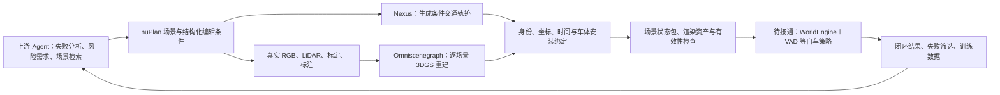

# Nexus＋Omniscenegraph 在 World Corner Agent 中的位置

核对日期：2026-10-26。依据 `ppt_files/world_corner.pptx` 第 7、8、10 页、演示 ZIP 内的框架文档，以及实际 Agent／WorldEngine 接口源码。演示流程与当前代码分别核对，未执行其他团队仓库中的服务或训练。

PPT 中的雨夜、30 秒时域、TTC 和碰撞率属于原材料的流程示意，不是我们当前实验已经取得的指标。

**我们当前建设的是工具池中的“场景重建＋条件轨迹生成＋可控场景渲染与验证”能力。尚未打通 WorldEngine 的闭环决策评测，也没有完成决策模型后训练。**

2026-10-26 任务澄清：当前优先交付的是“接收事件 → 编辑指定车辆局部轨迹 → Nexus 自由生成自车与其他车辆 → 验证交互 → 输出 3DGS 视频”。在这个分支中，自车未来应由 Nexus 生成。下文的外部自车策略、非自车候选接口与 WorldEngine 对接属于独立策略评测分支，保留作为后续接口研究，不是当前视频目标的前置条件。具体执行见 `nexus_timed_event_implementation_20261026.md`。

## 1. 与材料中的步骤对应

不同材料的编号不完全一致，下面以步骤名称为准。

| 材料 | 我们对应的位置 | 当前状态 |
| --- | --- | --- |
| PPT 第 7 页：八步总流程 | 第 2 步“场景重建”、第 4 步“可控编辑”；第 5～6 步的一部分准备与离线检查 | 已跑通一例认可的视觉基线和三个初步重建场景；没有完整交互闭环 |
| PPT 第 8 页：雨夜高速案例的十步流程 | 03 场景重建；05 场景编辑中的车辆运动；06 行为规划中的短时轨迹候选；08 的局部离线几何检查 | 当前预测未来为 8 秒，不是图中 30 秒长期闭环；天气、感知延迟等编辑没有接入 |
| 演示文档第 4～9 步 | `reconstruction`、`instance_discovery`、`edit_config_generator`／`scene_editor`、`scene_validator` 的相应能力 | 以 nuPlan 真值标注恢复身份，以 Nexus 条件采样生成运动，以 Omniscenegraph 重建和渲染；尚未注册为 Agent 的完整替换工具 |
| 演示文档第 10 步 `policy_runner` | 接收我们的场景，运行独立自车决策模型 | 尚未对接 |
| 后续 `failure_case_filter`、`policy_trainer` | 筛选实际被测策略的失败，形成有正确监督目标的数据并训练 | 我们尚未执行；不能把 Nexus 自车预测当专家标签 |

PPT 第 10 页把风险检索、3D 重建、补全、编辑、轨迹生成和仿真列为工具池。我们的工作属于其中的多个工具能力，不等于整个 World Corner Agent。Nexus 的四城推理与审计是模型侧验证；3DGS 资产训练是重建训练，两者均不能等同于 VAD 等决策模型的后训练。

## 2. 上游输入是什么

| 输入 | 来源与意义 | 当前实现 |
| --- | --- | --- |
| 风险需求、编辑意图 | Agent 的失败分析、场景需求和编辑方案，例如“前方公交停车，测试自车能否合理响应” | 当前用明确的结构化公交停车／记录行驶条件；自然语言到通用 Nexus 条件的 Agent 工具适配尚未实现 |
| 带身份的交通历史 | 各参与者位置、朝向、速度、尺寸、有效性；当前为 0.5 秒采样的 2 秒历史 | 从 nuPlan 场景特征获取。只有 RGB 视频不能直接替代这些状态输入 |
| 道路与场景身份 | DB、场景 token、地图、绝对时间、单位和坐标约定 | 已有 Nexus 地图片段和 nuPlan 地图来源；下游地图多边形、导航与配准还需验证 |
| 真实重建观测 | RGB、多相机标定、LiDAR、ego 位姿、3D 车辆标注与 token | 用于逐场景 3DGS 重建；不是由 Nexus 轨迹生成外观 |
| 重建资产和实例绑定 | 背景、车辆高斯、相机、道路安装参数、token→model index | 现有 v9 单场景基线；新地点使用各自重建的资产 |

核心约定是米制世界坐标、清楚的时间戳与唯一身份。nuPlan 自车状态参考后轴，物理车框中心约向前偏移 1.461 m；相机使用 OpenCV 右／下／前轴，不能与自车或地图坐标直接混用。Nexus 槽位也不等于高斯模型序号。

## 3. 下游输出是什么

**视频是检查和展示结果；真正需要交付的是可更新的场景状态、可渲染的资产和接口约定。**

| 输出 | 下游用途 |
| --- | --- |
| 背景交通的 token、真实尺寸、位姿／轨迹、有效性、时间戳与条件来源 | 加载动态参与者，区分给定公交、生成车辆和记录车辆 |
| 3DGS checkpoint、config、背景与独立车辆资产、道路／车体安装关系 | 在下游每一步按新位姿渲染；现有 checkpoint 不能直接当成 WorldEngine 原生资产 |
| 相机内外参、曝光时间和自车到相机的变换 | 根据实际自车策略的新位姿生成观测，而非继续播放预先生成的自车视角视频 |
| 地图、交通灯、导航／路线和坐标变换 | 支持策略输入与道路、TTC、碰撞、进度、舒适度评估 |
| 自车当前状态与历史 | 初始化被测策略；后续自车动作归被测策略所有 |
| 几何、画质和完整性检查 | 决定候选场景能否进入策略评测；输出成功不等于场景有效 |

闭环应是：**渲染当前观测 → 被测自车策略输出动作 → 更新自车状态与背景交通 → 再渲染下一步观测。** 一次生成整段轨迹再回放，目前属于离线条件响应诊断；其他车辆尚不会按新策略自车的实际历史重新响应。

## 4. 公交穿模在总流程中如何解释

本次公交停车／行驶实验给定 B1 的完整未来，自车未来由 Nexus 生成，随后使用 v9 资产渲染。原始预测已存在重叠，说明这个生成样本中的自车响应不足。

这不是已经运行了 WorldEngine／VAD 后得到的自车失败，不能当作下游策略评测成绩。当前交互视频分支允许 Nexus 自由生成自车；若进一步用于独立驾驶策略的闭环评测，则把非自车交通交给场景层，将自车控制权交给被测策略。Nexus 自车预测不能自动作为“正确驾驶轨迹”监督。

而且两组场景均检出非自车之间的额外重叠：槽位 9 与一个记录车辆共 12 个车辆对×帧样本，槽位 5 与另一个记录车辆共 2 个样本。其余无关背景冲突应单独处理，不能算成被测自车策略的责任。

## 5. 已继续完成的衔接工作

导出入口：`scripts/pipeline/export_nexus_agent_handoff.py`。

结果目录：`artifacts/nexus_3dgs/agent_handoff_20261026/`，包含 `bus_stop/` 和 `bus_follow_logged/` 两组候选包。

每组包括：

- `environment_render_states.npz`：22 辆非自车、80 个真实渲染时刻的车体位姿与尺寸；严格排除 ego。
- `native_generated_traffic.npz`：13 辆非自车的原始 Nexus 轨迹，保留原生采样与有效性。
- `ego_history.npz`、`ego_initial_state.json`：记录中的 2 秒历史和当前状态；不向策略提供自车未来指令。
- `sensor_calibration.json`、`map_reference.json`、`traffic_light_reference.json`：真实标定、地图来源、记录交通灯状态。
- `diagnostics/nexus_ego_future.npz`：单独保存的 Nexus 自车预测，只用于诊断。
- `case_manifest.json`、`export_audit.json`：来源哈希、角色、坐标、状态与接口缺口；根目录另有独立验证结果。

这两组包是**接口联调候选**，不是已接通 WorldEngine 的运行包。明确标记 `worldengine_ready=false`、`closed_loop_executed=false`、`policy_training_data_ready=false`。

当前包覆盖车辆，行人／自行车尚未单独动画化；候选包保留记录中的未来有效性 mask，且不做跨无效段外推。它不能代表完整障碍物覆盖或所有新视角均有效。

## 6. 接下来按什么顺序继续

1. 先明确候选场景有效性：保留公交风险条件，定位并处理无关背景冲突；任何轨迹修改另存并说明来源。
2. 接通 Omniscenegraph 的动态渲染接口。WorldEngine 当前消费 MTGS／DGGTScene 等专用资产；需要保留 v9 的 SH、天空、颜色变换和车辆安装关系，不能随意导出 PLY 后假定画质等价。
3. 对齐相机与策略输入。实际 VADv2 配置为 8 路相机；我们只有 4 路参与重建，最终只验收相机 0。不能复制前相机冒充其余相机。
4. 对齐米制地图、车辆中心／后轴、路线、历史与频率。Nexus 原生 0.5 秒采样，演示为近 0.1 秒的曝光时刻；Agent runner 还限制 40 或 60 帧，而现有演示为 80 帧。
5. 以上验证通过后，才执行一次独立策略的闭环 rollout，记录该策略真实动作、碰撞／近失、TTC 和舒适度，再筛选训练数据。若要背景车响应新自车行为，还需逐步反馈历史并重新采样，不能把固定轨迹回放称为反应式多智能体闭环。

本轮没有改变 v9、原始预测或已交付视频，没有启动 WorldEngine 或决策模型训练，也没有修改其他团队的仓库。
